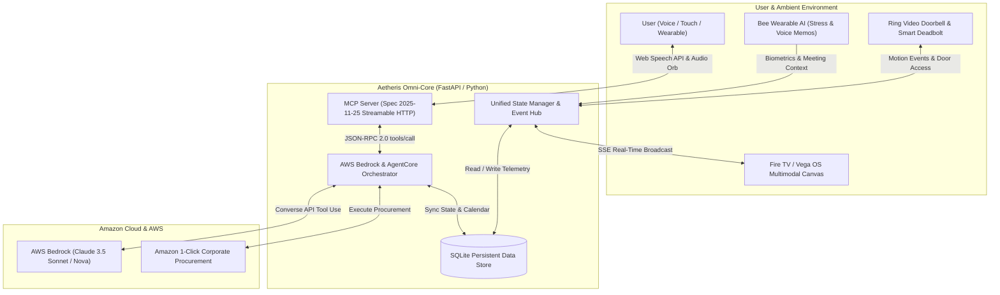

# 🌌 Aetheris Omni-Agent
### *Autonomous Cross-Device Ambient Intelligence for Alexa+, Ring, Bee & Fire TV*
**Built for the Amazon Developer Hackathon: Build, Ship, Shape 2026**

[](LICENSE)
[-00A8E1.svg)](https://modelcontextprotocol.io)
[](https://aws.amazon.com/bedrock/)
[](https://developer.amazon.com)

---

## 🏆 Hackathon Submissions & Track Declarations

| Category | Declaration | Tech Stack / Protocol |
| :--- | :--- | :--- |
| **Primary Track** | **Alexa+** | Self-hosted MCP Server (**Spec 2025-11-25**, Streamable HTTP / SSE) & Interactive Multi-Modal Web Simulator |
| **Mini-Challenge 1** | **AWS Builder** | AWS Bedrock (Claude 3.5 Sonnet / Amazon Nova) via Boto3 with AgentCore multi-turn reasoning and fallback |
| **Mini-Challenge 2** | **Open Source** | Full open-source release under the MIT License with complete architecture, tools, and testing documentation |
| **Bonus Points** | **10% Friction Log Bonus** | 5 comprehensive friction logs documented in [`FRICTION_LOGS.md`](FRICTION_LOGS.md) |

---

## 🧑‍⚖️ Step-by-Step Evaluation Guide for Judges (How to Test the Demo)

Welcome Amazon Developer Hackathon Judges! You can evaluate **Aetheris Omni-Agent** using either the video walkthrough or by running the full interactive live multi-device studio locally in under 60 seconds:

### Quick Evaluation Path (Under 2 Minutes)
1. **Watch Demo Video**:
   - 🎬 **Video File**: [`aetheris_demo_video.mp4`](aetheris_demo_video.mp4) (Duration: **2m 39s** | Full HD 1080p | Clear Spoken Narration + Real Telemetry).
   - 📜 **Demo Script & Timestamps**: [`DEMO_SCRIPT.md`](DEMO_SCRIPT.md).
   - ⚡ **Automated Video Builder**: Re-generate anytime with `python generate_demo_video.py`.
2. **Run Locally**:
   ```bash
   git clone https://github.com/rikarijit8-lab/aetheris-omni-agent.git
   cd aetheris-omni-agent
   pip install -r requirements.txt
   python run.py
   ```
3. **Open Studio**: Open `http://localhost:8000` in Google Chrome or Microsoft Edge.

### Step-by-Step Testing Checklist on `http://localhost:8000`:
- **Step 1 (Test 1-Click Scenarios)**:
  - Click **`📅 Calendar Collision`**: Watch Alexa+ detect the meeting collision via MCP tool `check_schedule_conflicts`, automatically move the overlapping session to 2:00 PM, and push the updated agenda to the Fire TV canvas.
  - Click **`📦 Courier & Restock`**: Watch Ring Video Doorbell verify an Amazon courier, temporarily disengage the smart deadbolt for 60 seconds, and trigger an Amazon 1-Click Prime restock order with an animated receipt.
  - Click **`🧘 Stress -> Ambience`**: Watch Bee Wearable telemetry report elevated cognitive load (78%), triggering 5,500K daylight focus lighting and muting secondary chimes.
  - Click **`✨ Full Symphony`**: Watch all 4 devices orchestrate simultaneously.
- **Step 2 (Test Alexa+ Voice & Mic)**:
  - Click the **Alexa Voice Orb** or microphone button (allow browser mic permissions if prompted).
  - Speak naturally (e.g. *"Order coffee"*, *"Check my schedule"*, or *"Set focus ambience"*).
  - Alexa will speak back via voice synthesis and display dynamic UI cards.
- **Step 3 (Inspect Device Hub Tabs)**:
  - Click through the top tabs on the right:
    - **`📅 Calendar & Agenda`**: Live meeting timeline and collision solver status.
    - **`🔔 Ring Security`**: 1080p HDR live camera stream, courier pass indicator, and deadbolt toggle.
    - **`🐝 Bee Wearable`**: Biometric heart rate (BPM), cognitive stress progress bar, and ambient voice notes.
    - **`📺 Fire TV Canvas`**: 4K Vega OS ambient card renderer and room lighting presets.
    - **`📦 Supplies & Prime`**: 1-Click procurement catalog and live order tracking.
- **Step 4 (Verify Model Context Protocol 2025-11-25 Specs)**:
  - Click the bottom drawer: **`Model Context Protocol (MCP 2025-11-25) • Streamable HTTP Inspector`**.
  - Review the real-time JSON-RPC 2.0 requests (`initialize`, `tools/list`, `tools/call`, SSE packets).
- **Step 5 (Verify Database Records via CLI)**:
  - Open terminal and run: `python check_db.py` to inspect all 6 SQLite tables and records directly.

---

## 💡 Executive Summary: Why Aetheris Stands Apart
Most hackathon smart home entries build obvious, single-turn wrappers around static APIs: asking a question, receiving a text answer, or toggling a light switch.

**Aetheris Omni-Agent** re-imagines ambient computing from the ground up:
- **Autonomous & Proactive (Not Just Reactive)**: Instead of waiting for fragmented commands, Aetheris continuously coordinates across devices. When your **Bee Wearable AI** detects elevated cognitive stress, or **Ring Doorbell** authenticates an Amazon courier at your door, or a **Calendar collision** is discovered, Aetheris autonomously plans and executes cross-device actions.
- **Open Standard Model Context Protocol (MCP Spec 2025-11-25)**: Powered by Streamable HTTP and Server-Sent Events (SSE), standardizing tool calling, dynamic UI cards (MCP Apps), and continuous telemetry streams.
- **Unified 4-Device Symphony**:
  1. **Alexa+**: Voice reasoning orb, multi-turn conversational agent, speech synthesis & recognition.
  2. **Ring Video Doorbell Pro 2 & Smart Deadbolt**: Live 1080p HDR buffer, courier authentication, 60-second temporary vestibule access pass.
  3. **Bee Wearable AI**: Real-time biometrics (resting heart rate, cognitive stress index), ambient speech-to-text meeting memos, on-wrist haptic coaching.
  4. **Fire TV (Vega OS)**: High-resolution living room ambient display with dynamic cards, auto-rescheduled agendas, and Amazon 1-Click order confirmation receipts.
  5. **AWS Bedrock**: Deep agentic reasoning using Anthropic Claude 3.5 Sonnet and Amazon Nova.

---

## 🏛️ System Architecture



---

## ✨ Key Features & Capabilities

### 1. Model Context Protocol (MCP Spec 2025-11-25) Native
- **Endpoints**:
  - `POST /mcp`: Standards-compliant JSON-RPC 2.0 handling `initialize`, `tools/list`, `tools/call`, `resources/list`, `resources/read`, and `prompts/list`.
  - `GET /mcp`: Streamable HTTP Server-Sent Events (SSE) streaming real-time notifications with automatic heartbeat keepalives.
- **10 Core MCP Tools**:
  - `check_schedule_conflicts`: Analyzes calendar collisions and suggests resolution windows.
  - `reschedule_event`: Shifts overlapping events to conflict-free slots.
  - `get_inventory_status`: Tracks office/home supplies and flags critical shortages.
  - `auto_procure_supplies`: Simulates Amazon 1-Click ordering with Prime delivery tracking.
  - `prepare_workspace_ambience`: Actuates CCT Kelvin (2400K-5500K), brightness, and DND modes.
  - `ring_inspect_doorbell`: Queries Ring Doorbell motion events and visitor snapshots.
  - `ring_grant_access`: Disengages smart deadbolt for 60s courier delivery with auto-relock.
  - `bee_get_wearable_telemetry`: Ingests heart rate, stress index, and ambient notes.
  - `firetv_push_canvas_card`: Dispatches visual cards/carousels to Fire TV screen.
  - `dispatch_cross_device_alert`: Synchronizes alert across Alexa+, Fire TV, and Bee wrist haptic.

### 2. Multi-Modal Web Studio & Simulated Alexa+ Experience
- **Interactive Alexa+ Orb**: Multi-ring animated orb with Web Audio API waveform visualizer reacting in real-time to speech synthesis.
- **Voice-Enabled**: Real-time microphone input via Web Speech API recognition and natural voice playback.
- **Dynamic MCP App Cards**: In-chat interactive cards for schedule resolution, Amazon Prime order receipts, Ring security status, and Bee biometric telemetry.
- **Real-Time MCP Protocol Inspector**: Collapsible bottom drawer inspecting every live JSON-RPC 2.0 packet with packet filters (`ALL`, `INCOMING`, `OUTGOING`, `INTERNAL`).

---

## 🚀 Quickstart & Setup Guide

### Prerequisites
- Python 3.10, 3.11, 3.12, 3.13, or 3.14.
- Modern Web Browser (Chrome, Edge, Brave, Firefox, Safari).

### 1. Clone & Install Dependencies
```bash
# Clone the repository
git clone https://github.com/rikarijit8-lab/aetheris-omni-agent.git
cd aetheris-omni-agent

# Install dependencies
pip install -r requirements.txt
```

### 2. Configure Environment (Optional AWS Bedrock Live Mode)
Create a `.env` file in the root directory (optional - Aetheris runs out-of-the-box in Intelligent Autonomous Mode without requiring live AWS credentials):
```env
AWS_ACCESS_KEY_ID=your_access_key_here
AWS_SECRET_ACCESS_KEY=your_secret_key_here
AWS_DEFAULT_REGION=us-east-1
AWS_BEDROCK_MODEL_ID=anthropic.claude-3-5-sonnet-20241022-v2:0
```
> **Note for Judges**: Aetheris contains a dual-mode resilient architecture. If AWS credentials are not supplied, it automatically runs an autonomous high-fidelity reasoning engine that mirrors the AWS Bedrock AgentCore execution flow with zero errors!

### 3. Launch the Application
```bash
python -m mcp_server.server
```
or with Uvicorn directly:
```bash
uvicorn mcp_server.server:app --host 0.0.0.0 --port 8000 --reload
```

### 4. Open the Web Dashboard
Navigate to `http://localhost:8000` in your browser.
- **MCP Endpoint**: `http://localhost:8000/mcp`
- **SSE Stream**: `http://localhost:8000/mcp` or `http://localhost:8000/api/events`

---

## 🎯 Testing Curated Demo Scenarios (One-Click for Judges)

In the top bar of the web dashboard, click any of the scenario chips to witness cross-device orchestration:

1. **📅 Auto-Resolve Calendar Conflict**:
   - Inspects schedule, detects a collision between an Executive Keynote and Operations Sync.
   - Reschedules the conflict to 2:00 PM and broadcasts the updated agenda to the Fire TV Canvas.
2. **📦 Ring Courier + 1-Click Restock**:
   - Ring Doorbell verifies an Amazon Prime courier.
   - Disengages the smart deadbolt for 60 seconds with an audit log.
   - Detects low coffee supply and triggers Amazon 1-Click Corporate procurement with Prime delivery ETA.
3. **🧘 Bee Stress Spike -> Focus Ambience**:
   - Ingests Bee Wearable AI telemetry showing elevated cognitive stress (78%).
   - Adjusts smart workspace lighting to 5,500 Kelvin daylight white, mutes secondary chimes, and delivers on-wrist coaching.
4. **✨ Complete Cross-Device Symphony**:
   - Executes the synchronized orchestration of all 4 Amazon devices in one seamless flow.

---

## 👥 Amazon Developer Relations Collaborator Access

As required by the official hackathon rules, if this repository is set to private, the following Amazon Developer Relations team members must be invited as collaborators under **Settings > Collaborators > Add people**:

- **Kourtney Meiss**: `knmeiss` ([Profile](https://github.com/knmeiss))
- **Giovanni Laquidara**: `giolaq` ([Profile](https://github.com/giolaq))
- **Anisha Malde**: `anishamalde` ([Profile](https://github.com/anishamalde))
- **Moses Roth**: `mosesroth` ([Profile](https://github.com/mosesroth))
- **Emerson Sklar**: `emersonsklar` ([Profile](https://github.com/emersonsklar))
- **Devpost Testing**: `testing@devpost.com`

---

## 📂 Project Repository Structure

```text
├── LICENSE                     # MIT Open Source License
├── README.md                   # Complete Architecture & Hackathon Documentation
├── requirements.txt            # Python dependencies (FastAPI, Uvicorn, Boto3, Pydantic)
├── PRODUCT_FEEDBACK.md         # Devpost Product Feedback responses for Amazon teams
├── FRICTION_LOGS.md            # 5 Detailed Friction Logs for the 10% Judging Bonus
├── FEATURE_REQUESTS.md         # Categorized Feature Requests for Amazon products
├── DEMO_SCRIPT.md              # 2m 45s precise demo video recording script
├── mcp_server/
│   ├── __init__.py             # Package exposure
│   ├── server.py               # FastAPI MCP Spec 2025-11-25 Streamable HTTP Server
│   ├── tools.py                # 10 MCP Tool definitions and SQLite operations
│   ├── state_manager.py        # Real-time state hub & scenario runner
│   ├── orchestrator_aws.py     # AWS Bedrock Converse & AgentCore reasoning loop
│   └── concierge_data.db       # SQLite local database
└── web_simulator/
    ├── index.html              # Futuristic Cyber-Ambient Alexa+ Dashboard
    ├── style.css               # Glassmorphic CSS with animations & responsive grid
    ├── app.js                  # SpeechRecognition, SpeechSynthesis, SSE & Protocol Inspector
    └── static/                 # Ring Camera SVG, Fire TV Canvas SVG, Courier banners
```

---

## 📜 Open Source License

This project is licensed under the **MIT License** - see the [LICENSE](LICENSE) file for details.

